<!-- Panels in assets/ are generated by scripts/build_assets.py -->

  
  
  

**Building AI voice agents or LLM-powered products? Let's talk.**

<b>📄 Plain-text version</b>

### Vasik Mansuri · Technical Lead & AI Engineer

Technical Lead at **Vnnovate Solutions** with 6+ years of experience, based in Ahmedabad, India. I build AI voice agents that hold real phone calls, and the custom LLM models that power them.

**AI work**
- **Voice calling agents:** Twilio Voice with the OpenAI Realtime API, silence and noise thresholds for natural turn-taking, and function calls during the call for booking, lookups and CRM updates.
- **Custom LLM models:** my own LLM models built for specific product tasks, served behind production APIs alongside GPT-4, with RAG pipelines grounded in company data.
- **Agent orchestration:** LangChain context management for multi-turn tasks, tools wired to business APIs and webhooks, calendar sync with Google Workspace and Microsoft Graph.
- **AI in production:** Node.js services with Redis queues and caching, Dockerised deploys on AWS and GCP with CI/CD.

**Projects**
- **NurtureMe, AI recruiting platform** (Technical Lead): built "Stella", an AI voice agent that phones candidates over Twilio and OpenAI Realtime, with LangChain orchestration, AI matching and automated calendar booking.
- **Custom LLM models:** built my own LLM models for domain-specific tasks and integrated them into production with RAG and function calling.
- **Jaguar Land Rover South Africa, dealer management system** (core architecture): inventory sync pipelines, lead tracking portals and live analytics dashboards.
- **High-traffic APIs and microservices:** secure REST and GraphQL APIs tuned with DB indexing, Redis caching and background queues.

**Stack:** OpenAI (GPT-4, Realtime API), LangChain, Twilio, RAG, function calling · Node.js, Express, TypeScript, GraphQL, Laravel, PHP · React, Vue.js, Tailwind CSS · MySQL, MongoDB, Redis, Firebase · AWS, GCP, Docker, Nginx, GitHub Actions

**Experience**
| Role | Company | Period |
|---|---|---|
| Technical Lead / Software Development Manager | Vnnovate Solutions Pvt. Ltd. | Jul 2025 – Present |
| Senior Software Engineer | Vnnovate Solutions Pvt. Ltd. | Jul 2024 – Jun 2025 |
| Full Stack Developer | Vnnovate Solutions Pvt. Ltd. | Sep 2021 – Jun 2024 |
| Web Developer | Elsner Technologies Pvt. Ltd. | Dec 2019 – Sep 2021 |

**Education:** MCA, GLS University (2018–2020) · BCA, St. Xavier's College (2015–2018)

