<!-- ============================ HERO BANNER ============================ -->
<div align="center">



<a href="https://github.com/vasikmansuri">
  
</a>

<!-- ============================ VISITOR COUNTER ============================ -->
<p>
  
  
</p>

<!-- ============================ SOCIAL BADGES ============================ -->
<p>
  <a href="https://www.linkedin.com/in/vasik-mansuri-94b9ab190"></a>
  <a href="mailto:mansurivasik@gmail.com"></a>
</p>

</div>

---

## 🧑‍💻 About Me

> **Technical Lead & Senior Full Stack Engineer** with 6+ years building and scaling enterprise SaaS platforms, cloud-native backends and AI-powered voice systems.

- 🧭 **Technical Lead at Vnnovate Solutions**: I lead an engineering team from early architecture through to multi-server production, and run sprint planning, code reviews and mentoring.
- 🤖 Built **"Stella"**, a real-time AI voice recruiter on **Twilio Voice + OpenAI Realtime API**, with **LangChain** handling multi-turn conversation flows.
- 🚗 Core architecture on an **enterprise dealer management system for Jaguar Land Rover South Africa**: inventory sync pipelines, lead tracking and live analytics dashboards.
- 🏗️ I build end to end: **Laravel / Node.js** APIs, **React / Vue** frontends, **MySQL / MongoDB / Redis** data layers, and **Docker + CI/CD** on **AWS & GCP**.
- 💳 Integrated payment and productivity platforms: **Stripe, PayPal, Razorpay, Braintree**, plus **Google Workspace** and **Microsoft Graph** calendars.
- 🌍 Based in **Ahmedabad, India** 🇮🇳

```typescript
const vasik: TechnicalLead = {
  role: "Technical Lead / Senior Full Stack Engineer",
  experience: "6+ years",
  backend: ["Laravel", "Node.js", "Express", "REST", "GraphQL"],
  frontend: ["React", "Vue.js", "TypeScript", "Tailwind CSS"],
  ai: ["OpenAI Realtime API", "GPT-4", "LangChain", "Twilio Voice AI", "RAG"],
  cloud: ["AWS", "GCP", "Docker", "Nginx", "CI/CD"],
  currentFocus: "AI voice agents and scalable SaaS architecture",
};
```

---

## 🛠️ Tech Stack

<div align="center">

**⚙️ Backend**

     

**🎨 Frontend**

     

**🤖 AI & Automation**

    

**🗄️ Databases & Cloud**

     

**🚀 DevOps & Tools**

     

**💳 Integrations**

    

</div>

---

## 🏢 Where I've Shipped

| Project | What I Built |
|---|---|
| 🤖 **NurtureMe: AI Recruiting Platform** | Technical Lead. Enterprise SaaS for candidate indexing, AI matching and scheduling, plus "Stella", a real-time voice agent (Twilio + OpenAI Realtime + LangChain) |
| 🚗 **Jaguar Land Rover South Africa: Dealer Management System** | Core architecture. Nationwide dealership backend, inventory sync pipelines, lead tracking portals and analytics dashboards |
| ⚡ **High-traffic APIs & microservices** | Secure REST APIs for web and mobile backends, tuned with DB indexing, Redis caching and Laravel queues |
| 🛒 **E-commerce & payments** | Laravel and Magento storefronts with Stripe, PayPal, Razorpay, Braintree and Authorize.Net |

*Most of my professional work is closed source and owned by clients or my employer.*

---

## 🌟 Open Source

<div align="center">

<a href="https://github.com/vasikmansuri/tokyo-night-macos-setup">
  
</a>

</div>

---

## 💼 Experience

| Role | Company | Period |
|---|---|---|
| **Technical Lead / Software Development Manager** | Vnnovate Solutions Pvt. Ltd. | Jul 2025 – Present |
| **Senior Software Engineer** | Vnnovate Solutions Pvt. Ltd. | Jul 2024 – Jun 2025 |
| **Full Stack Developer** | Vnnovate Solutions Pvt. Ltd. | Sep 2021 – Jun 2024 |
| **Web Developer** | Elsner Technologies Pvt. Ltd. | Dec 2019 – Sep 2021 |

🎓 **MCA**, GLS University (2018–2020) · **BCA**, St. Xavier's College (2015–2018)

---

## 📫 Contact

<div align="center">

| | |
|---|---|
| 💼 **LinkedIn** | [Vasik Mansuri](https://www.linkedin.com/in/vasik-mansuri-94b9ab190) |
| ✉️ **Email** | [mansurivasik@gmail.com](mailto:mansurivasik@gmail.com) |
| 🐙 **GitHub** | [@vasikmansuri](https://github.com/vasikmansuri) |

</div>

---

<div align="center">

**⭐ If something here helped you, a star goes a long way!**

*Built in India 🇮🇳 · Technical Lead · Full Stack & AI Integration*

<sub>Keywords: Technical Lead · Senior Full Stack Engineer · Laravel · Node.js · React · Vue.js · TypeScript · OpenAI Realtime API · LangChain · Twilio Voice AI · AI Voice Agents · AWS · GCP · Docker · MySQL · MongoDB · Redis · REST APIs · GraphQL · SaaS Architecture</sub>

</div>
